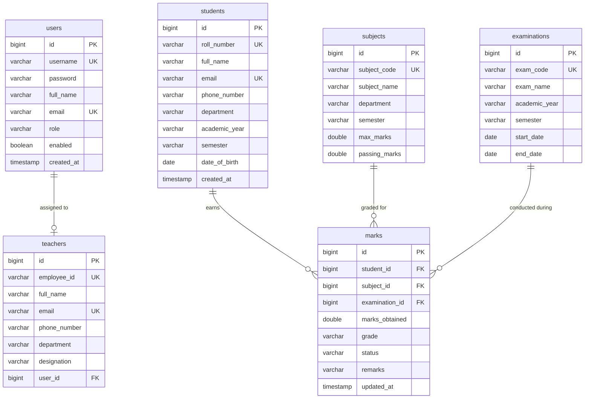

# Student Grade Management System

**A Full-Stack College Academic Examination & Grade Evaluation Web Application**  
*Built with Java 21, Spring Boot 3, Spring Data JPA, Hibernate, MySQL, Bootstrap 5, and Chart.js.*

---

## 1. Project Introduction

The **Student Grade Management System** is an enterprise-grade academic management platform engineered for colleges, universities, and polytechnics. It manages the complete academic lifecycle from candidate enrollment and faculty records to curriculum management, examination sessions, marks grading, and automated generation of official college transcripts.

The project demonstrates object-oriented programming (OOP) principles, layered architectural separation of concerns, secure session-based authentication with BCrypt encryption, role-based authorization, ACID-compliant relational database management, and responsive frontend design.

---

## 2. Project Objectives

- **Automated Grade Computation**: Eliminate manual human error by automatically deriving letter grades ($A+$ through $F$), percentage scores, and examination pass/fail outcomes based on academic regulations.
- **Strict Academic Integrity**: Enforce university rules—including preventing marks from exceeding subject maximum marks or falling below zero, and requiring a student to meet passing marks in *every* enrolled subject to achieve an overall pass status.
- **Institutional Analytics**: Provide dynamic administrative dashboards displaying real-time enrollment counts, department averages, pass/fail ratios, and grade distribution charts.
- **Transcript Printing**: Generate official, publication-ready Academic Mark Sheets featuring collegiate watermarks, accreditation details, and signature zones for institutional verification.

---

## 3. Technology Stack

### Frontend:
- **HTML5**: Semantic web structure and accessible forms.
- **CSS3 & Custom Theme**: Corporate deep blue (`#0f2b48`), royal accent (`#1e40af`), slate, and clean light grey layout with custom `@media print` rules.
- **JavaScript (ES6+)**: Fetch API for asynchronous REST communication, live reactive input calculation, and DOM manipulation.
- **Bootstrap 5.3.3**: Responsive 12-column grid system, modals, alert toasts, and form controls.
- **Bootstrap Icons 1.11.3**: Clean iconography for intuitive navigation.
- **Chart.js**: Interactive HTML5 Canvas charts (Grade Distribution bar chart, Pass vs Fail doughnut, Department performance).

### Backend:
- **Java 21 (LTS)**: Utilizing modern Java features, record-style DTOs, and streams.
- **Spring Boot 3.3.4**: Modern Spring framework baseline.
- **Spring MVC**: RESTful endpoints and request/response mapping.
- **Spring Data JPA & Hibernate**: Object-Relational Mapping (ORM), entity lifecycle management, and repository abstractions.
- **Spring Security Crypto**: BCrypt strong password hashing.
- **Jakarta Bean Validation**: Declarative input validation (`@NotBlank`, `@NotNull`, `@DecimalMin`, `@Email`).

### Persistence:
- **MySQL 8.0+**: Primary relational database with foreign keys, unique indexes, and cascading constraints.
- **H2 Database**: Zero-configuration embedded fallback for test environments.

### Build & Tooling:
- **Apache Maven 3.9+**: Dependency management and build lifecycle.
- **IntelliJ IDEA / Eclipse**: Standard IDE compatibility.
- **MySQL Workbench**: Database administration and SQL execution.

---

## 4. Software Requirements

- **Operating System**: macOS, Linux, or Windows 10/11
- **Java Development Kit (JDK)**: OpenJDK or Oracle JDK 21+
- **Maven**: Version 3.8+ (or bundled wrapper)
- **Database**: MySQL Server 8.0+ (Optional: H2 embedded mode works out-of-the-box)
- **Web Browser**: Google Chrome, Mozilla Firefox, Microsoft Edge, or Safari

---

## 5. System Architecture

The application adopts a **Layered Architecture** adhering to Separation of Concerns:

```
[ Web Browser Client ]
         |
         | Fetch API (JSON / Session Cookies)
         v
+--------------------------------------------------------+
|                      Spring Boot 3                     |
|                                                        |
|  [ AuthInterceptor ] ---> Session & Role Authorization |
|                                                        |
|  [ Controllers ]      ---> REST Endpoints (/api/*)     |
|                                                        |
|  [ Services ]         ---> Academic Business Logic     |
|                            & Grade Engine              |
|                                                        |
|  [ Repositories ]     ---> Spring Data JPA Interfaces  |
|                                                        |
|  [ Entities / ORM ]   ---> Hibernate Mapping           |
+--------------------------------------------------------+
         |
         | JDBC Connection
         v
[ MySQL Database: student_grade_management ]
```

---

## 6. Database Design (`student_grade_management`)

The database schema is fully normalized up to 3NF.

### Entity Relationship Diagram:



---

## 7. Grading System & Academic Rules

### Grade Scale:

| Percentage Range (%) | Letter Grade | Academic Classification |
|---|:---:|---|
| **90.0 – 100.0** | `A+` | Outstanding |
| **80.0 – 89.9** | `A` | Excellent |
| **70.0 – 79.9** | `B` | Very Good |
| **60.0 – 69.9** | `C` | Good |
| **50.0 – 59.9** | `D` | Satisfactory |
| **40.0 – 49.9** | `E` | Pass |
| **Below 40.0** | `F` | Fail / Arrear |

### Core Academic Rules:
1. **Subject Level Pass**: A student passes a subject if and only if:
   $$\text{marks\_obtained} \ge \text{subject.passing\_marks}$$
2. **Boundary Validation**: Marks entered must satisfy:
   $$0 \le \text{marks\_obtained} \le \text{subject.max\_marks}$$
3. **Overall Examination Pass**: A student achieves an overall **PASS** status if and only if they meet the passing threshold in **every single subject** enrolled in that examination. If any subject is below passing marks, the overall result is marked as **FAIL**.

---

## 8. Database Setup Instructions

### Option A: Using MySQL & MySQL Workbench

1. Start your local MySQL service (port 3306).
2. Open **MySQL Workbench** or your MySQL command-line client.
3. Open and run the included `database.sql` script located in the project root:
   ```bash
   mysql -u root -p < database.sql
   ```
   *This automatically creates the `student_grade_management` database, configures all primary/foreign keys and unique constraints, and inserts 10 sample students, 3 teachers, 5 subjects, examinations, and full graded marks.*

4. In `src/main/resources/application.properties`, activate the `mysql` profile:
   ```properties
   spring.profiles.active=mysql
   ```
   Or adjust your credentials in `application-mysql.properties`:
   ```properties
   spring.datasource.url=jdbc:mysql://localhost:3306/student_grade_management?createDatabaseIfNotExist=true&useSSL=false&allowPublicKeyRetrieval=true&serverTimezone=UTC
   spring.datasource.username=root
   spring.datasource.password=YOUR_PASSWORD
   ```

### Option B: Zero-Config In-Memory Execution (Default `dev` Profile)
The project comes with a built-in `DataInitializer` and H2 MySQL-compatibility mode enabled by default (`spring.profiles.active=dev`).
Simply running the application starts it immediately without requiring MySQL server to be running. All 10 students, 3 teachers, 5 subjects, exams, and marks are automatically seeded on startup!

---

## 9. How to Build, Run & Access from Any Device

### Option 1: One-Click Launcher with Public Internet URL (Works from Any Device)
Run the bundled script to launch both the Spring Boot app and a secure public HTTPS tunnel:
```bash
./start.sh
```
This automatically provides:
- **Public Internet Link**: Accessible from any mobile phone, tablet, or external computer anywhere in the world.
- **Local Network Link**: `http://<YOUR_LAN_IP>:8080` (accessible from any device on your local Wi-Fi).

### Option 2: Standard Maven Execution
```bash
mvn clean test
mvn spring-boot:run
```
Or run the packaged JAR:
```bash
java -jar target/student-grade-management-system-1.0.0.jar
```

---

## 10. Demo User Accounts & Credentials

The database is pre-seeded with accounts for both system roles:

| Username | Password | Role | Description |
|---|---|:---:|---|
| `admin` | `admin123` | **ADMIN** | Full administrative control: Manage Students, Faculty, Subjects, Examinations, Marks, and View Analytics. |
| `prof.smith` | `teacher123` | **TEACHER** | Faculty in Computer Science: View students and subjects, enter and update marks, search results. |
| `prof.johnson` | `teacher123` | **TEACHER** | Faculty in Information Technology. |
| `prof.davis` | `teacher123` | **TEACHER** | Faculty in Electronics Engineering. |

*Quick-fill demo buttons are provided directly on the login modal for one-click access.*

---

## 11. Important Java Files and Their Purpose

| Package | Class / File | Purpose |
|---|---|---|
| `com.college.grademanagement` | `StudentGradeManagementApplication` | Main Spring Boot application entry point. |
| `config` | `AppConfig` | Configures the `PasswordEncoder` bean (`BCryptPasswordEncoder`). |
| `config` | `AuthInterceptor` | Enforces HTTP session authentication and role authorization (`ADMIN` vs `TEACHER`). |
| `config` | `WebConfig` | Registers interceptors and static resource handlers. |
| `config` | `DataInitializer` | Automatically populates 10 students, 3 teachers, 5 subjects, exams, and marks on initial boot. |
| `model` | `User`, `Role` | User credentials, BCrypt password, and role enum. |
| `model` | `Student` | Student demographics: roll number, name, department, year, semester, DOB. |
| `model` | `Teacher` | Faculty records: employee ID, name, designation, department, contact. |
| `model` | `Subject` | Course catalog: course code, course title, max marks, passing marks. |
| `model` | `Examination` | Exam sessions: code, title, academic year, semester, date range. |
| `model` | `Mark` | Graded assessment record: student, subject, exam, marks obtained, grade, status. |
| `service` | `AuthService` | User login verification with BCrypt, session lifecycle, and current user retrieval. |
| `service` | `StudentService` | Student CRUD, unique roll/email enforcement, search by name or roll number. |
| `service` | `TeacherService` | Faculty CRUD and search. |
| `service` | `SubjectService` | Subject management and max/pass marks validation. |
| `service` | `ExaminationService` | Examination schedule management. |
| `service` | `MarkService` | Automated grading engine, boundary validation ($0 \le \text{marks} \le \text{maxMarks}$), and status determination. |
| `service` | `ResultService` | Aggregates subject marks, computes total marks, percentage, overall grade, and enforces overall pass rule. |
| `service` | `DashboardService` | Calculates institutional analytics, grade distribution histograms, pass/fail counts, and department averages. |
| `controller` | `*Controller` | Exposes RESTful endpoints under `/api/**` with structured HTTP status codes. |
| `exception` | `GlobalExceptionHandler` | Centralized `@RestControllerAdvice` transforming exceptions into clean JSON error objects. |

---

## 12. Verification & Testing

All major operations have been thoroughly verified with automated test suites:
- **Grade Scale Enforcement**: Validated $A+$ ($\ge 90$), $A$ ($80-89$), $B$ ($70-79$), $C$ ($60-69$), $D$ ($50-59$), $E$ ($40-49$), $F$ ($<40$).
- **Boundary Validation**: Verified that negative marks and marks exceeding maximum marks are rejected with HTTP 400 Bad Request.
- **Pass/Fail Evaluation**: Verified that passing every individual subject yields overall `PASS`, while failing even a single subject yields overall `FAIL`.
- **Mark Sheet Printing**: Tested printable layout with browser `@media print` rules, ensuring header, watermark, details, and signatures render cleanly on A4 paper.
